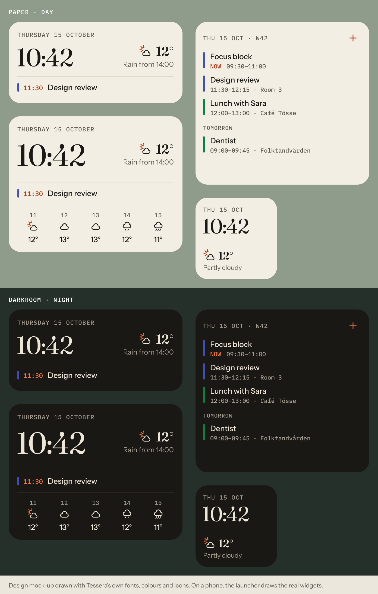

# Tessera

A home-screen widget maker for Android that a complete beginner can use in two minutes.
Like KWGT, without the formulas, the layer tree or the guesswork about sizing.

**Open source · any Android 8+ phone · no AI · no accounts · no ads · no paid features**

Design mock-up drawn with the app's own fonts, colours and icons. On a phone, your launcher draws the real widgets.

> **Status: first preview, not yet tested on many phones.** Download it from [Releases](https://github.com/Zirren-Git/WidgetApp/releases). Every push is built by GitHub Actions: 87 unit tests, Android lint (0 warnings) and a debug APK. The widget editor comes next. The full plan is in [`docs/PRODUCT_SPEC.md`](docs/PRODUCT_SPEC.md).

## What's in this build

- **Morning Paper** widget in three sizes: date, a big clock that never runs late, today's weather ("Rain from 14:00"), your next event, and the next five hours on the large size.
- **Up Next** widget: today and the coming days from the calendars on your phone, with calendar colours, a "now" marker, "Day 2 of 3" for trips, and **+** to add an event.
- **Weather that just works:** MET Norway forecasts with no API key. Search for a city or use your location (rounded to about 1 km). Units follow your region, so a Swedish phone gets °C and m/s.
- **Calendar without fuss:** choose which calendars to show, hide declined events, merge duplicates, or show "Busy" instead of titles.
- **Health check** that answers "why isn't my widget updating?" and offers one-tap fixes.
- **Paper** (day) and **Darkroom** (night) themes, or your wallpaper's colours on Android 12+.

## Install

1. On your phone (Android 8.0 or newer), open [Releases](https://github.com/Zirren-Git/WidgetApp/releases) and download the newest `tessera-….apk`.
2. Open the file. If Android asks, allow your browser or file manager to install apps.
3. Open Tessera, tap **Add to home screen** on Morning Paper, then choose a place under **Weather**.

Releases marked **Pre-release** are previews: debug-signed and installed as a separate app (`com.zirren.tessera.debug`). Uninstall a preview before installing the next one. From 1.0, releases are signed with Tessera's own key and update in place.

## Build it

You need [Android Studio](https://developer.android.com/studio), a current stable version. The project uses AGP 9.4 and Gradle 9.6; Android Studio downloads them for you.

1. Clone the repo and open the folder in Android Studio.
2. Let Gradle sync. The first sync downloads dependencies.
3. Choose a phone or emulator running Android 8.0 or newer and press **Run**.
4. In Tessera, tap **Add to home screen** on Morning Paper, then choose a place under **Weather**.

From a terminal, `./gradlew :app:assembleDebug` builds the APK and `./gradlew :core:model:test :core:weather:test :core:calendar:test` runs the unit tests.

## How it's built

| Module | What's in it |
|---|---|
| `core/model` | Places, units and regional defaults, date and time formatting |
| `core/weather` | MET Norway client and parser, feels-like, sunrise and sunset, rain outlook, refresh policy, city search |
| `core/calendar` | Agenda engine: filters, all-day handling, grouping, labels, when the widget next needs redrawing |
| `app` | Android: widgets (RemoteViews), background jobs (JobScheduler), Compose screens |

The `core` modules are plain Kotlin with no Android dependencies, so their tests run on any JVM. Clocks are drawn by your launcher (`TextClock`), so Tessera never needs a background service to keep time.

Weather data from [MET Norway](https://api.met.no/) (CC BY 4.0). Place search from GeoNames via [Open-Meteo](https://open-meteo.com/) (CC BY 4.0). Fonts: Fraunces, Instrument Sans and IBM Plex Mono (SIL OFL 1.1; licences in `app/src/main/assets/licenses`).

## Releasing

Tessera is distributed only through [GitHub Releases](https://github.com/Zirren-Git/WidgetApp/releases). Publishing a release (tag `vX.Y.Z`) runs [`.github/workflows/release.yml`](.github/workflows/release.yml): it runs the tests, builds the APK from that tag and attaches it with `SHA256SUMS.txt`.

For properly signed releases, add these repository secrets (Settings → Secrets and variables → Actions): `TESSERA_KEYSTORE_BASE64` (the keystore file, base64-encoded), `TESSERA_KEYSTORE_PASSWORD`, `TESSERA_KEY_ALIAS` and `TESSERA_KEY_PASSWORD`. Until then, releases are debug-signed previews. Keep an offline backup of the keystore: updates depend on it forever.

## License

[MIT](LICENSE)
